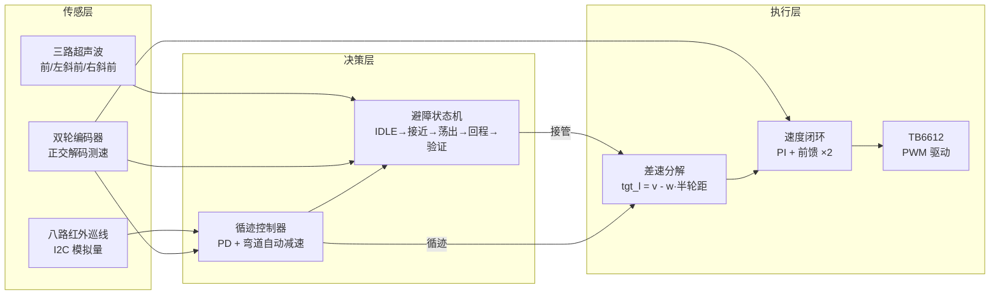

# SilkRoadCar — STM32 循迹避障智能小车

基于 **STM32F103C8T6** 的两轮差速循迹避障小车，为电子设计竞赛赛道任务开发：
黑线循迹 + 4 个障碍物连续绕行 + 终点横线检测停车，全程闭环、无开环时序。

> 控制周期 10ms（使用真实 dt）｜ PD 循迹 ｜ 圆弧避障状态机 ｜ 编码器全程闭环

---

## 系统架构



**优先级**：避障状态机接管时循迹暂停；回线验证窗通过后无缝交还。

## 功能特性

- **PD 循迹**：8 通道模拟量加权求线偏差，Kp·e + Kd·de 转向，偏差越大自动减速
- **圆弧避障**：检测到障碍后不停车，以两段连续圆弧（荡出 + 回程）绕行，全程平滑
- **回线验证窗**：20mm 内统计 ≥2 探头压黑占比，防赛道黑字误判
- **盲绕保护**：分不清障碍侧时弧线自动降速（220mm/s），方向判定成功恢复正常速度
- **追加转向**：荡出到位后复查正前，仍有障碍则每次追加 15°（上限 +45°）
- **终点检测**：出发 26s 后武装，循迹状态下 ≥4 探头同时压黑立即刹车

## 硬件清单

| 模块 | 型号/规格 | 接口 |
|---|---|---|
| 主控 | STM32F103C8T6 最小系统板 | — |
| 循迹 | 8 路红外反射模块（模拟量输出） | I²C（SCL=PA2，SDA=PA3，地址 0x5D） |
| 测距 | HC-SR04 ×3（正前 + 左右斜前 45°） | Trig/Echo（PA6/PA7、PB0/PB1、PB8/PB9） |
| 驱动 | TB6612FNG 双路 | PWMA=PA0、PWMB=PA1，方向 PB12~PB15 |
| 编码器 | 正交编码器 ×2（13 线 ×4 倍频 ×减速比 20.409） | TIM3/TIM4 |
| LED | 板载 PC13 | 状态指示（等待慢闪/运行常亮/避障 2Hz/故障爆闪） |

## 目录结构

```
SilkRoadCar/
├── Core/
│   ├── Inc/
│   │   ├── app_config.h        # 全部可调参数结构体 + 方向修正宏 + 运行模式
│   │   ├── app.h               # 顶层状态机接口
│   │   └── ...
│   └── Src/
│       ├── main.c              # CubeMX 生成入口
│       ├── app.c               # 顶层状态机：WAIT→RUN→DONE/FAULT
│       ├── app_config.c        # g_param 参数默认值（调参主入口）
│       ├── line_follow.c       # PD 循迹 + 丢线找线
│       ├── obstacle.c          # 避障状态机（圆弧策略）
│       ├── chassis.c           # (v,w)→双轮速度→PID→PWM
│       ├── bsp_track.c         # 巡线模块 I²C 驱动与黑白判定
│       ├── bsp_ultrasonic.c    # 超声波分时轮询
│       ├── bsp_encoder.c       # 编码器测速与里程
│       └── bsp_motor.c         # TB6612 PWM 与方向控制
├── Drivers/                    # HAL 库（CubeIDE 生成）
├── docs/
│   └── 控制策略说明.md          # 详细控制策略文档（报告用）
├── SilkRoadCar.ioc             # CubeMX 工程配置
└── STM32F103C8TX_FLASH.ld      # 链接脚本
```

## 快速开始

1. **导入**：STM32CubeIDE → File → Import → Existing Projects into Workspace → 选择本目录
2. **选择运行模式**：`Core/Inc/app_config.h` 中修改 `CFG_APP_MODE`

| 模式 | 宏 | 行为 |
|---|---|---|
| 正式比赛 | `APP_MODE_RUN` | 3s 倒计时 → 循迹+避障 → 终点停车 |
| 电机方向测试 | `APP_MODE_TEST_MOTOR` | 腾空验证两轮转向与编码器极性 |
| 传感器观察 | `APP_MODE_TEST_SENSOR` | 车不动，Live Expressions 看传感器数据 |
| 闭环直行 | `APP_MODE_TEST_STRAIGHT` | 调速度环、标定轮径 |
| 原地转 360° | `APP_MODE_TEST_PIVOT` | 标定轮距 |
| 纯循迹 | `APP_MODE_TEST_LINE` | 不避障不判终点 |
| 避障单项 | `APP_MODE_TEST_AVOID` | 直行遇障碍绕行测试 |

3. **编译烧录**：Hammer 图标编译 → Run/Debug 烧录（ST-Link）

## 参数调优速查（`app_config.c` → `g_param`）

所有参数可在调试器 Live Expressions 中在线修改，满意后抄回源文件。

| 参数 | 当前值 | 作用 | 调大/调小的影响 |
|---|---|---|---|
| `v_cruise` | 300 | 循迹巡航速度（第 1~2 次避障段） | ↑快但弯道易外甩 |
| `line_kp` | 0.090 | 转向比例强度 | ↑跟线紧但可能蛇形 |
| `line_kd` | 0.0055 | 转向阻尼 | ↑压振荡，过大反应迟钝 |
| `w_max` | 6.0 | 转向角速度上限 | 需满足 5×65 < 车速，否则内轮倒转 |
| `v_avoid` | 250 | 绕行弧速度 | 半径 R = v_avoid / w_arc |
| `w_arc` / `w_arc_back` | 1.8 / 1.2 | 荡出/回程曲率（避障1专属，其余 1.5/1.0） | ↑圈小动作急 |
| `obs_detect_mm` | 350 | 正前识别距离 | ↑早发现，跑道更长 |
| `obs_decide_mm` | 250 | 转向判定距离（与 detect 之差 = 减速段） | 必须小于 detect |
| `finish_arm_ms` | 26000 | 终点判定武装时间 | **必须小于单圈用时**，否则跑两圈 |
| `finish_black_cnt` | 4 | 终点横线探头数 | ↑防黑字误停，↓易触发 |
| `us_slot_ms` | 15 | 超声波轮询周期 | 太小回波测不完 |

**避障几何公式**：圆弧半径 R = `v_avoid` ÷ `w_arc`；横向让开量 ≈ R × (1 − cos 荡出角)。
**速度分段**：第 1~2 次避障段 300（`app_config.c` 默认值）→ 第 2 次避障完成后 370（`obstacle.c` → `finish_avoid()` 的 `count==2||3` 块）。

## 调试指南

- **实时观察**：Debug 模式下将 `g_dbg`、`g_param` 加入 Live Expressions
  - `g_dbg.odom`：里程 ｜ `g_dbg.line_pos`：线偏差 ｜ `g_dbg.obs_state`：避障状态机状态
  - `g_dbg.run_ms`：单圈计时（出发开始、停止结束）——**标定终点武装时间的依据**
- **LED 状态速查**：慢闪=等待 ｜ 快闪=循迹模块离线 ｜ 常亮=运行 ｜ 2Hz=避障进行中 ｜ 熄灭=完成 ｜ 爆闪=故障
- **经典问题排查**：
  - 左/右轮该正转却倒转 → 查 `w_max` 是否 ≤ 车速÷65，或方向宏 `CFG_MOTOR_x_REVERSE` 与 `CFG_ENC_x_REVERSE` 是否成对
  - 避障后原地转圈找线 → 回线验证窗判据（≥2 探头）与荡出角让开量的匹配问题
  - 终点不停反而跑两圈 → `finish_arm_ms` 大于了实际单圈用时

## 版本记录

| 日期 | 版本要点 |
|---|---|
| 2026-10-22 | 圆弧避障状态机定稿：两段连续圆弧 + 回线验证窗 + 盲绕保护 + 追加转向 |
| 2026-10-22 | 终点检测改时间武装 + 多探头压黑即停 |
| 2026-10-24 | 两段速度策略（300/370）+ 逐次避障专属几何 + 首次提交 GitHub |
